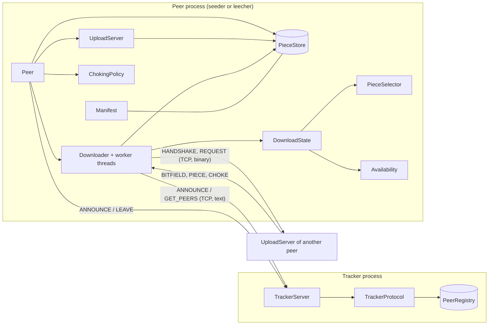
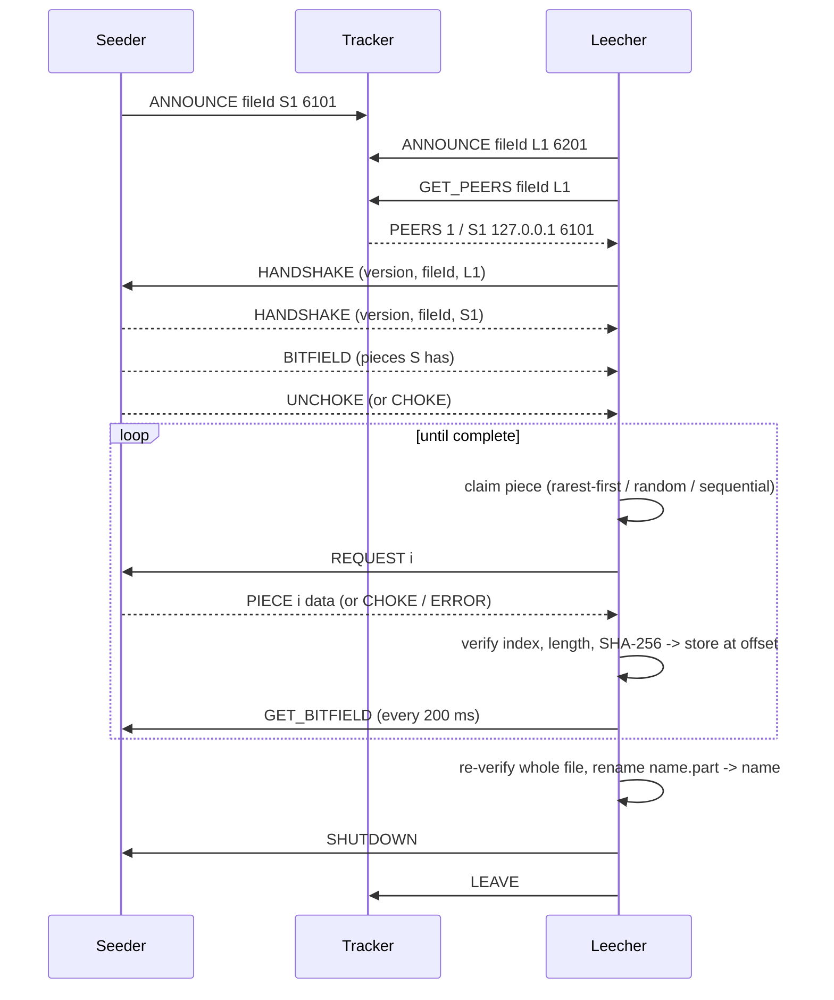

# CampusTorrent architecture

CampusTorrent is a BitTorrent-lite system for sharing study material. A file is cut into fixed-size pieces, every piece has a SHA-256 hash in a *manifest*, and peers exchange pieces directly over TCP using our own protocol (`docs/protocol.md`). A **tracker** only introduces peers; it never carries file data. No BitTorrent/P2P library is used: only `java.net`, `java.io`, `java.nio.file`, `java.util.concurrent` and `java.security`.

## Component diagram

| Package | Responsibility |
|---|---|
| `tracker` | Tracker server, registry with expiry, request handling, client used by peers |
| `protocol` | Message types, framing, handshake, `PeerConnection` (socket + timeouts) |
| `pieces` | Manifest, splitter, SHA-256, piece store, reassembly |
| `scheduler` | Availability counts and the three piece-selection strategies |
| `peer` | Seeder/leecher glue: upload server, downloader, choking policy, CLI |
| `experiment` | In-JVM swarm harness, experiment runner, CSV, sample file generator |
| `util` | Argument parsing, logging, validation, path safety, rate limiter |

## Message flow of one download

## Threads and shared state

* **Tracker**: one acceptor thread, a pool of 16 handler threads (one short request per connection), one janitor thread purging expired peers every second. The registry is a `ConcurrentHashMap` of `ConcurrentHashMap`s.
* **Peer**: one acceptor thread plus one handler thread per inbound connection (`UploadServer`, at most 64 inbound); a discovery thread and one worker thread per remote peer (`Downloader`); a small scheduled pool for choking rounds, tracker re-announce and progress logging.
* **Shared objects** are made thread-safe by `synchronized` methods: `PieceStore`, `DownloadState` (so two workers never fetch the same piece), `Availability`, `PieceSelector`, `ChokingPolicy`; counters use `AtomicLong`.

## Reciprocity model

Our peers have two kinds of connections: *we download* from a remote peer (outbound worker) and *the remote downloads from us* (inbound handler). The remote's contribution to us is the number of verified bytes our outbound worker received from it; `ChokingPolicy` uses that to decide which inbound requests to serve. Details are in `ChokingPolicy`'s Javadoc and `docs/testing-and-experiments.md`.

## Design decisions

1. **TCP for everything.** The proposal suggested UDP for piece data. UDP would need sequence numbers, retransmission and integrity handling; TCP already provides those, and every piece is additionally hash-verified. Decision: TCP only, no UDP.
2. **Tracker is plain text, peers are binary.** Easy to debug with `nc`, while piece transfer stays compact.
3. **Pull-based bitfields.** There is no HAVE push message; a leecher re-requests the bitfield every 200 ms. This keeps each connection a simple request/response loop at the cost of slightly stale availability.
4. **Simulated bandwidth.** Loopback is far faster than a real network, so a per-peer upload cap (`--upload-kbps`) is applied; it is the only simulated element of the experiments.
5. **Deterministic selection.** Rarest-first breaks ties by scanning pieces in rotated order from a per-peer offset (offset 0 = lowest index). Random uses a seeded `Random`.
